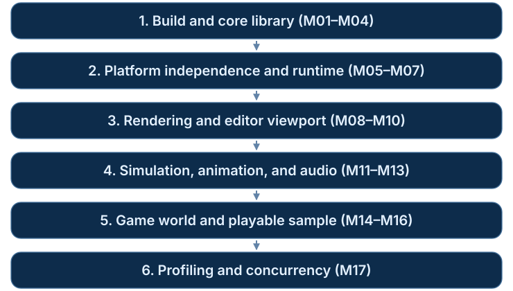

# Building a Game Engine from Scratch

[Progress handoff](progress-handoff.md)

Build a cross-platform C++ game engine, starting with Windows and preferably MSVC for the first build. The final exercise is to lay out a 3D room in a standalone editor, save it, then play it both inside the editor and in a standalone sample. The player can move, collect items, hear sound effects, see their score, and restart after clearing the room.

## Implementation flow

| Stage | Main work | Milestone |
| --- | --- | --- |
| 1. Build and core library (M01–M04) | Set up the engine library and sample. Add subsystem lifecycle, logging, memory management, and math. | The sample links to the engine library and runs in Debug and Release. |
| 2. Platform independence and runtime (M05–M07) | Define window and event interfaces, then add a Windows backend, a fixed-step loop, input, and resource management. | The application opens a window, responds to input, and loads resources from files. |
| 3. Rendering and editor viewport (M08–M10) | Draw a triangle, then add cameras, meshes, materials, lighting, and offscreen rendering. | The standalone editor displays a 3D model that can be inspected with an orbit camera. |
| 4. Simulation, animation, and audio (M11–M13) | Implement collision, simple dynamics, skeletal animation, and spatial audio. | Separate demos show a falling sphere, a skinned mesh following its skeleton, and sound changing with source position. |
| 5. Game world and playable sample (M14–M16) | Manage scene objects, add selection, editing, saving, and playtesting, then integrate pickups and scoring. | Playtest the same 3D room in Editor and complete it in Sandbox. |
| 6. Profiling and concurrency (M17) | Measure a loading baseline, then implement a job queue and asynchronous resource reads. | Compare the longest frame, total loading time, and peak memory use under the same conditions. |

## How to use this roadmap

- Work through the numbered items in order. Each group lists its prerequisites and the recommended order within the group.
- For reading-only items, read the listed sections and figures. For implementation items, complete the stated check and record the result in the handoff as **Awaiting user acceptance**. Mark the item `- [x]` and advance after the user confirms acceptance.
- I refers to [Volume I · Foundations and Core Engine Systems](<../reading_lists/Game Engine Architecture Volume I, Foundations and Core Engine Systems.pdf>).
- II refers to [Volume II · Graphics, Motion, and Sound](<../reading_lists/Game Engine Architecture Volume II Graphics, Motion, and Sound.pdf>).
- Both volumes are from Jason Gregory's fourth edition. The sections identify what to read. The exercises and completion checks are specific to this project. PDF page numbers count the cover as page 1.

## Stage 1 · Build and core library

### M01 Build targets

Start here.

- [ ] M01.01 **The boundary between the sample and the engine**. Read Volume I §1.5, starting on PDF page 47, including Figure 1.16.
- [ ] M01.02 **Engine library target** (I §2.2.1–2.2.2, from PDF page 85). Compile a function that returns a version number into a static library.
- [ ] M01.03 **Standalone sample entry point** (I §2.2.2–2.2.3). Link a separate executable against the engine library. Run it and print the version number.
- [ ] M01.04 **Build configurations** (I §2.2.4). Build and run both Debug and Release. Record a reproducible command for each configuration.

### M02 Subsystem lifecycle and diagnostics

Prerequisite: M01.

- [ ] M02.01 **Log output** (I §10.1.1–10.1.2). Write a message with a severity level and verify that it appears in the console or debugger.
- [ ] M02.02 **Error reporting** (I §3.2). Pass an invalid configuration and verify that the caller can read the specific cause of failure.
- [ ] M02.03 **Subsystem startup order** (I §6.1.1–6.1.2). Use two small services to verify that logging starts before the service that depends on it.
- [ ] M02.04 **Reverse shutdown order** (I §6.1.2). On a normal exit, use the log to verify that each service shuts down exactly once, in reverse startup order.
- [ ] M02.05 **Rollback on startup failure** (I §6.1, §3.2). Make the second service fail during startup. Verify that the first service is released and the failure reason remains available.

### M03 Memory, containers, and identifiers

Prerequisite: M02.

- [ ] M03.01 **Memory alignment** (I §3.3, §6.2.1.3). For an arbitrary starting address, calculate a 16-byte-aligned address and verify that it is divisible by 16.
- [ ] M03.02 **Linear allocator** (I §6.2.1.1). Make two allocations from a fixed buffer. Verify that their ranges are disjoint and an allocation exceeding capacity fails.
- [ ] M03.03 **Per-frame temporary memory** (I §6.2.1.4). Simulate two consecutive frames. After resetting the allocator, the second frame can reuse the first frame's space.
- [ ] M03.04 **Allocation statistics** (I §10.9). Check current usage and the high-water mark after allocation and after reset.
- [ ] M03.05 **Persistent dictionary** (I §6.3.6). Insert and look up entries by name in a standard container. Verify that entries survive a frame allocator reset.
- [ ] M03.06 **String identifiers** (I §6.4.3). Register the same name twice and get the same ID. Verify that two different names can each be looked up.

### M04 Math and coordinate conventions

Prerequisite: M01.

- [ ] M04.01 **Handedness and axes** (I §5.2.1–5.2.2). Document the world's right, up, and forward directions and express them as three unit vectors.
- [ ] M04.02 **Points and directions** (I §5.2.3–5.2.4). Calculate the displacement between two known points. Add it to the starting point to recover the endpoint.
- [ ] M04.03 **Dot product** (I §5.2.4). Use parallel, perpendicular, and opposite unit vectors to obtain 1, 0, and −1 respectively.
- [ ] M04.04 **Cross product** (I §5.2.4). Use the chosen axis convention to verify the normal generated by two edges. Swap the edges and verify that the normal reverses.
- [ ] M04.05 **Matrix multiplication conventions** (I §5.3.3–5.3.4, §5.3.14). Document which side of a matrix the vector occupies. Use an asymmetric matrix to verify the implementation's row and column order.
- [ ] M04.06 **Homogeneous coordinates** (I §5.3.8–5.3.9). Apply the same translation matrix to a point and a direction. Only the point changes.
- [ ] M04.07 **Transform composition** (I §5.3.9, §5.3.11). Rotate a point and then translate it. Compare a hand calculation with the result of the composed matrix.
- [ ] M04.08 **Inverse transforms** (I §5.3.6). Apply a transform and its inverse to a point. Recover its original position within tolerance.
- [ ] M04.09 **Quaternion rotation** (I §5.4.1–5.4.4). Rotate a direction by 90° about a unit axis. Compare the result with the equivalent rotation matrix.
- [ ] M04.10 **Rotation interpolation** (I §5.4.5). Interpolate halfway between two orientations 90° apart around the same axis. Verify a 45° rotation.

## Stage 2 · Platform independence, frame loop, and resources

### M05 Platform independence layer and main loop

Prerequisites: M02 and M03.

See Volume I §1.5.5, Figure 1.18 (PDF page 53). The sample supplies the window title and size. The Windows backend owns the native handle and translates native close messages into close requests that the main loop handles. See [Platform independence](../AGENTS.md#platform-independence) for platform boundaries and port verification.

- [ ] M05.01 **Platform-independent interface** (I §1.5.5). Define the public interface for creating a window and reading events. A caller can compile against engine headers alone. Parameters and return values use standard C++ or engine types.
- [ ] M05.02 **Windows window backend** (I §1.5.5, §8.3.1). Link the Windows implementation into the sample and use the M05.01 interface to create a window with the requested title and size.
- [ ] M05.03 **Windows messages and engine events** (I §8.3.1). Click the close button. The sample receives a close request through the public interface and exits normally.
- [ ] M05.04 **Monotonic clock** (I §8.5.3–8.5.4). Read time in seconds from the engine clock in the main loop. Successive readings never decrease, and the caller needs only the engine header.
- [ ] M05.05 **Frame loop** (I §8.1–8.2, §8.5.1). Run several consecutive frames. Record a frame number and one update call per frame.
- [ ] M05.06 **Fixed-step updates** (I §8.5.2). Set a 10 ms step. Feed in four 10 ms frames, then repeat with two 20 ms frames. Both runs advance the simulation four steps.
- [ ] M05.07 **Pause and game time** (I §8.4.1–8.4.2). Pause the simulation and verify that its step count stays fixed while the window remains responsive. Resume without catching up on paused time.

### M06 Input and action mapping

Prerequisite: M05.

- [ ] M06.01 **Keyboard state** (I §9.2, §9.3.1). Hold a key and read it as down each frame. Release it and read it as up.
- [ ] M06.02 **Button transitions** (I §9.5.4.1). Hold a key for three frames and then release it. Record one press event and one release event.
- [ ] M06.03 **Action mapping** (I §9.5.7). Rebind the Move action from W to an arrow key. The same movement code works for both bindings.
- [ ] M06.04 **Input across simulation steps** (I §9.5.4, §8.5.2). Feed a single press into a frame with zero simulation steps followed by a frame with two steps. Consume the action exactly once.

### M07 Files, configuration, and resource management

Prerequisites: M02 and M03.

- [ ] M07.01 **Resource root configuration** (I §6.5.1). Change the configuration and verify that the program reports the new resource root.
- [ ] M07.02 **Resource path resolution** (I §7.1.1). Launch from two different working directories. Supply the same explicit resource root and resolve the same file in both runs.
- [ ] M07.03 **Synchronous file reads** (I §7.1.2). Read back the exact bytes of a known file. A missing-file error reports the path.
- [ ] M07.04 **Resource loader** (I §7.2.1, §7.2.2). Parse a test file into a typed resource. Corrupt the file and verify that loading reports an error.
- [ ] M07.05 **Resource registry and cache** (I §7.2.2.4–7.2.2.5). Request the same ID twice in succession and verify that only one load occurs.
- [ ] M07.06 **Resource handles and unloading** (I §7.2.2.6). Share a resource between two users. It remains usable after the first releases it and can be unloaded after the last release.

## Stage 3 · Rendering and visual diagnostics

### M08 Graphics device and first frame

Prerequisites: M02 and M05.

- [ ] M08.01 **Graphics backend and device** (II §11.3.1, §11.4.4, §11.4.7). Choose a graphics API, create a device, and log the backend actually in use.
- [ ] M08.02 **Render target and clear** (II §11.3.4, §11.4.8). Clear the window to a chosen color and present it. Verify the color on screen.
- [ ] M08.03 **Vertex buffer** (II §11.3.6, §11.4.9). Upload three colored vertices. Check the buffer size in bytes, attribute offsets, and vertex stride.
- [ ] M08.04 **Shaders** (II §11.4.10). Compile or link a minimal set of shaders. Deliberately misspell a variable and verify that the diagnostic is visible.
- [ ] M08.05 **Triangle draw** (II §11.4.1–11.4.2, §11.4.8). Bind the buffer and shaders and issue one draw call. Verify the triangle and its interpolated colors.
- [ ] M08.06 **Window resize** (II §11.3.4, §11.4.8). Update the render target and viewport after a resize. Rendering resumes after minimizing and restoring the window.
- [ ] M08.07 **Offscreen render target** (II §11.3.4, §11.4.9). In Sandbox, draw a triangle into a color texture with a depth attachment. Display the texture in the window and verify that it still displays after resizing the target.

### M09 Camera, meshes, materials, and editor viewport

Prerequisites: M04, M06, M07, and M08.

- [ ] M09.01 **Model transform** (II §11.3.8). Move or rotate a set of vertices while reusing the original vertex buffer.
- [ ] M09.02 **View matrix** (II §11.3.2, §11.3.8). Given a camera position and target, verify that transforming the target into view space places it on the viewing axis.
- [ ] M09.03 **Perspective projection** (II §11.3.9). Draw identical geometry at two depths. The more distant copy occupies less screen space.
- [ ] M09.04 **Camera controls** (II §11.3.2, I §9.5.7). Orbit a target using input actions. Verify that the target stays near the center of the image.
- [ ] M09.05 **Indexed mesh** (II §11.3.6). Draw two triangles sharing an edge using four vertices and six indices.
- [ ] M09.06 **Mesh resource loading** (I §7.2.2, II §11.3.6). Load the same mesh file twice and share one mesh resource.
- [ ] M09.07 **Depth buffer** (II §11.3.11). Reverse the submission order of two overlapping objects. The nearer surface still occludes the farther one.
- [ ] M09.08 **Texture sampling** (II §11.3.14). Use an orientation-marked checkerboard to check the direction of the UV axes and their mapping to all four corners.
- [ ] M09.09 **Material binding** (II §11.3.14, §11.4.8). Draw two instances of the same mesh with different materials. Each instance displays its assigned appearance.
- [ ] M09.10 **Standalone Editor application** (I §2.2.2–2.2.3, II §16.4). Add an editor target that links Engine. Launch Editor and Sandbox independently. Building Sandbox alone requires only game and runtime dependencies.
- [ ] M09.11 **Scene viewport** (II §11.3.4, §16.4). Display the M08.07 color texture in an Editor panel using the M09 mesh renderer. Resize the render target and update the camera aspect ratio when the panel's usable dimensions change.
- [ ] M09.12 **Editor camera and input focus** (I §9.5.8, §10.5, II §16.4). Orbit the model with the editor camera. Type movement keys in a panel text field and verify that the camera stays still.

### M10 Lighting and rendering diagnostics

Prerequisite: M09.

- [ ] M10.01 **Normal transforms** (I §5.3.13). Apply nonuniform scaling to a sloped surface. The transformed normal's dot product with each of two tangent vectors stays near zero.
- [ ] M10.02 **Directional light and diffuse shading** (II §12.4.2, §12.5.1). Hold the model and light fixed. Orbit the camera and verify that the diffuse brightness of the same surface point stays constant.
- [ ] M10.03 **Debug normal drawing** (I §10.2.1). Draw a line segment for each surface normal so outward orientation is visible.
- [ ] M10.04 **Single-frame GPU inspection** (II §12.9.4). Capture a frame and locate the triangle draw. Check the mesh and material actually bound for that draw.
- [ ] M10.05 **CPU frame timing** (I §10.8). Time the update and draw-submission stages separately. Read both durations from one run.

## Stage 4 · Simulation, animation, and audio

### M11 Collision queries and simple dynamics

Prerequisites: M04 and M05. Use M10 for visualization.

- [ ] M11.01 **Collision shapes** (I §5.6.2–5.6.3, II §14.3.4). Define a sphere by its center and radius and the ground by a unit normal and a point on the plane.
- [ ] M11.02 **Sphere–plane contact** (II §14.3.3, §14.3.5). Test a sphere above, touching, and penetrating the plane. Check contact state and penetration depth in each case.
- [ ] M11.03 **Gravity integration** (II §14.4.2, §14.4.4). Let a sphere fall freely for one fixed step. Calculate its new velocity and position by hand and compare with the simulation.
- [ ] M11.04 **Contact response** (II §14.4.7). Release a sphere with no bounce. Verify that it comes to rest on the ground with penetration depth within tolerance.
- [ ] M11.05 **Debug collision shapes** (I §10.2.1, II §14.3.2). Overlay the sphere shape and contact normal. Compare their locations with the rendered sphere and ground.
- [ ] M11.06 **Spherical trigger** (II §14.3.5, §14.3.7). Move one sphere through another sphere's trigger region. The query detects overlap and still allows the moving sphere to pass through.

### M12 Skeletal animation and skinning

Prerequisites: M04, M05, M07, and M09.

- [ ] M12.01 **Skeleton hierarchy** (II §13.2.1–13.2.2). Build a two-joint skeleton and traverse it in parent-before-child order.
- [ ] M12.02 **Local and model-space poses** (II §13.3.2–13.3.3). Rotate only the parent joint. The child's local pose stays fixed while its model-space position changes.
- [ ] M12.03 **Keyframe sampling** (II §13.4.1, §13.4.4–13.4.5). Sample two keyframes at the endpoints and midpoint. Check the resulting translations and rotations.
- [ ] M12.04 **Skinning matrices** (II §13.3.1, §13.5.2). Build a matrix palette from the current pose and inverse bind matrices. In the bind pose, each resulting matrix is close to identity.
- [ ] M12.05 **Vertex skinning** (II §13.5.1–13.5.2). Draw a weighted two-joint mesh. Moving a joint moves only the vertices it influences.
- [ ] M12.06 **Pose blending** (II §13.6.1, §13.9). Vary the blend weight between idle and walking poses. Recover the original poses at the endpoints and transition smoothly between them.

### M13 Audio playback and spatial positioning

Prerequisites: M04 and M07. Use M06 for the interactive demo.

- [ ] M13.01 **Sound resource** (II §15.3.2, §15.5.7). Load a short sound and check its channel count, sample rate, and duration.
- [ ] M13.02 **Single playback** (II §15.5.1–15.5.2). Create a playback instance. Verify that the sound is audible and the instance is reclaimed when it finishes.
- [ ] M13.03 **Overlapping playback** (II §15.5.2–15.5.3). Trigger the same sound twice. Stop one playback instance and verify that the other continues.
- [ ] M13.04 **Stereo positioning** (II §15.4.2, §15.4.4). Move a source from the listener's left to right. Verify that the louder channel switches sides.
- [ ] M13.05 **Distance attenuation** (II §15.4.3). Keep the source in the same direction and move it farther away. Verify that the recorded playback gain decreases.

## Stage 5 · Game world and playable sample

### M14 World, components, and editor selection

Prerequisites: M03, M04, and M05. The editor panels and viewport use M09.

- [ ] M14.01 **Object lifecycle** (II §16.1–16.2, §17.2.1). Create and destroy two objects in the World. Check the active object count after each operation.
- [ ] M14.02 **Object handles** (II §17.5.3). Delete an object and reuse its slot. The old handle is invalid, and the new handle resolves only to the new object.
- [ ] M14.03 **Transform component** (II §17.2.2, I §5.5.5). Change the transforms of two objects independently and verify that neither change affects the other object.
- [ ] M14.04 **Mesh component** (II §17.2.2, I §7.2.2.6). Share a mesh between two objects. Delete one and verify that the other still renders.
- [ ] M14.05 **World update order** (II §17.6.1–17.6.3). Request another object's deletion during an update. Traversal completes and queries on the next step match the agreed deletion semantics.
- [ ] M14.06 **Scene object panel** (II §16.4, §17.5.3). List objects in the current world and select one by clicking its name. Clear the selection when that object is deleted.
- [ ] M14.07 **Viewport picking** (II §16.4, §17.5.4). Click a mesh to select its instance in the object panel. With two overlapping objects, select the visible surface. Click empty space to clear the selection.
- [ ] M14.08 **Creating objects in Editor** (II §16.4, §17.2.2). Create an object with transform and mesh components from the panel. Verify that it appears in the viewport. Delete it and confirm that other instances sharing the mesh remain visible.

### M15 Scene editor, persistence, and playtesting

Prerequisites: M07, M09, and M14. The playtest uses the physics update from M11. Store IDs that survive across sessions in scene files. Runtime handles are valid only within their own world.

- [ ] M15.01 **Scene data format** (II §16.3, §17.3.2). Describe objects, transforms, and mesh resource IDs as data. Write a minimal room scene file.
- [ ] M15.02 **Scene instantiation** (II §17.4.1). Read the scene and instantiate its objects. Verify their count, positions, and resource references.
- [ ] M15.03 **Selected object properties** (II §16.4). Select an object in Editor and edit its position. It moves on the next frame, while other instances retain their positions.
- [ ] M15.04 **Scene saving** (II §16.4, §17.3.2). Save the edited scene and restart. Verify that positions and shared mesh references are restored.
- [ ] M15.05 **Opening a scene** (II §16.4, §17.4.1). Open another scene in Editor. The viewport and object panel switch together. Attempt to open a corrupt file and verify that current edits are preserved.
- [ ] M15.06 **Transform gizmo** (II §16.4, I §5.3.11). Drag a selected object along one world axis in the 3D viewport. The properties panel updates, and the saved position survives reopening.
- [ ] M15.07 **Switching between Edit and Play** (II §16.4, §17.6, §17.10). Start Play to create a separate runtime world from the editing scene and let a ball fall. Stop and verify that it returns to its editing position. Repeat twice with consistent results.
- [ ] M15.08 **Pause and step** (I §8.4, §10.5). Pause playtesting and single-step. The ball advances one fixed simulation step and Editor remains responsive.

### M16 Events, gameplay, and game flow

Prerequisites: M06 and M10–M15.

- [ ] M16.01 **Event dispatch** (II §17.8.2, §17.8.5, §17.8.8). Register a listener and send one event. Verify that the listener receives exactly one notification.
- [ ] M16.02 **Player movement** (II §14.5.1–14.5.2, I §9.5.7). Hold the Move action to move the character across the room floor. Release it to stop.
- [ ] M16.03 **Action state transitions** (II §13.10.4–13.10.5). Transition from idle to walking when movement begins, and blend back to idle when the character stops.
- [ ] M16.04 **Pickup rules** (II §14.3.7, §17.8.5). Remove the collectible when the player enters its trigger region. Remaining there for multiple updates produces only one pickup event.
- [ ] M16.05 **Score display** (II §12.8, §17.8.5). Subscribe to pickup events and update the on-screen counter. Each item adds one point.
- [ ] M16.06 **Pickup sound** (II §15.5.2, §17.8.5). Have an audio listener play the sound once per pickup. The pickup logic only sends the event.
- [ ] M16.07 **Completion condition** (II §17.10). Collect the last item and verify that the game transitions from playing to complete.
- [ ] M16.08 **Restart** (II §17.10, §17.4.1). Restart from the completion screen. The character, collectibles, and score all reset, and the room can be completed again.
- [ ] M16.09 **Editor and standalone acceptance check** (II §16.4, §17.4.1, §17.10). Place and save a collectible in Editor. Pick it up in Play and verify the score. After Stop it is back in its editing position. Close Editor, open the same file in Sandbox, and repeat the pickup and completion checks.

## Stage 6 · Profiling and concurrency

### M17 Profiling, jobs, and asynchronous loading

Prerequisites: M07, M10, and M16.

- [ ] M17.01 **Synchronous loading baseline** (I §2.3, §10.8). For a fixed batch of resources, record the longest frame, total loading time, and peak memory use under synchronous loading. Save the test conditions.
- [ ] M17.02 **Background job queue** (I §4.5–4.8, §8.6.4). Submit jobs with distinct IDs and verify that each executes exactly once.
- [ ] M17.03 **Asynchronous resource reads** (I §7.1.3, §8.6.1). Read a file on a background worker while the main loop continues updating. Compare the result with the synchronous read.
- [ ] M17.04 **Publishing resources on the main thread** (I §7.2.2, II §17.7.2). A query returns a loading state until loading finishes. After publication, the complete resource is available.
- [ ] M17.05 **Shutdown during loading** (I §4.6–4.8, §6.1). Close the sample while a slow job is running. Verify that the thread has finished before the resource manager is destroyed.
- [ ] M17.06 **Before-and-after comparison** (I §2.3, §10.8–10.9). Repeat the baseline under the same conditions. Report the longest frame, total loading time, and peak memory usage separately.

## Further reading after the main roadmap

| Topic | Sections |
| --- | --- |
| Geometry processing and visual effects | II §11.6 |
| Stochastic ray tracing | II §12.6 |
| Post-processing | II §12.7 |
| Animation post-processing | II §13.7 |
| Animation compression | II §13.8 |
| Animation constraints | II §13.11 |
| Motion matching | II §13.12 |
| Game scripting | II §17.9 |
| Lock-free concurrency | I §4.9 |
| SIMD vectorization | I §4.10 |
| General-purpose GPU computing | I §4.11 |
| Other engine systems and gameplay topics | II Chapter 18 |
