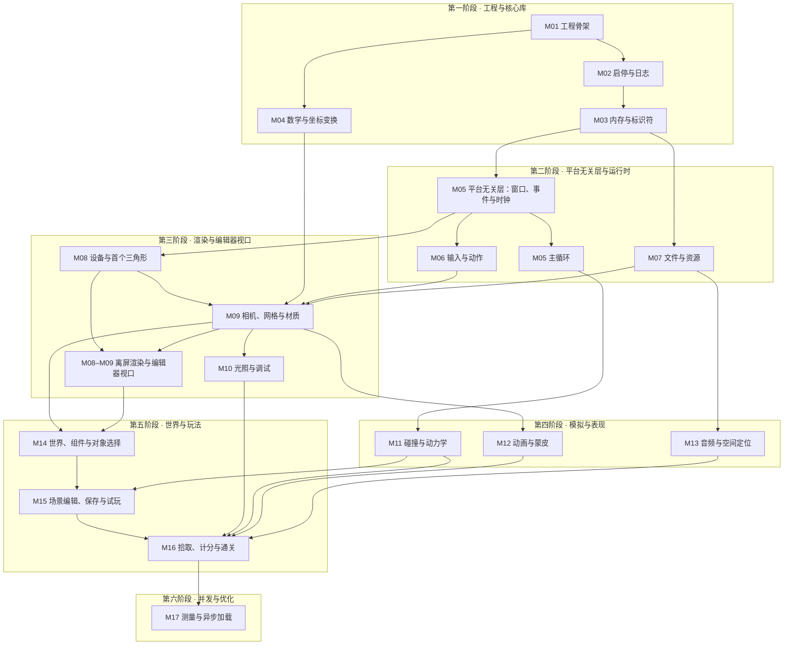

# 从零构建游戏引擎：分层阅读与实现路线

[English version](roadmap.en.md)

目标是一个跨平台 C++ 游戏引擎，首先在 Windows 上实现和验证，首版建议使用 MSVC。最终用独立编辑器摆出一间 3D 房间，保存后既能在编辑器内试玩，也能由独立样例载入。玩家能够移动、拾取物品、听到音效、看到得分，并在通关后重新开始。

## 当前进度

**M01.01 引擎与样例的边界** · 待读，练习待开始。

- **本次阅读**　第一卷 §1.5，从 PDF 第 47 页开始，重点看图 1.16。
- **完成标志**　画出样例程序与引擎库之间的调用方向，并标出窗口和渲染分别属于哪一层。
- **下一模块**　M01.02 引擎库目标。读第一卷 §2.2.1–2.2.2（PDF 第 85 页起），将一个返回版本号的函数编译成静态库。

## 平台无关层（Platform Independence Layer）

对应第一卷 §1.5.5、图 1.18（PDF 第 53 页）。在 M05 先定义窗口与事件的公共接口，再为它实现 Windows 后端。上层主循环通过该接口接收事件。例如用户点击关闭按钮时，后端将原生消息转换为引擎的“请求关闭”事件，由主循环决定退出。

- **核心与玩法**　数学、资源管理、世界对象和游戏逻辑使用标准 C++ 或引擎自己的类型。例如样例请求创建窗口时只传标题和尺寸，原生窗口句柄由平台实现持有。
- **Windows 首版**　窗口和消息处理首先接入 Windows。时钟、文件和线程优先使用满足需求的标准 C++ 接口；需要原生能力时，由构建目标选入对应平台的实现文件。
- **设备后端**　输入模块将设备按键转换为引擎按键或动作。图形 API 到 M08.01 再选，图形设备与音频设备的原生类型由各自后端管理。场景文件保存资源 ID 或相对路径。
- **迁移验收**　第二个平台确定后，复用核心、玩法和同一份样例资源，补齐该平台需要的实现。先验证开窗、输入和三角形绘制，再运行房间样例，检查声音、拾取与重新开始。按平台记录实际通过的项目。

## 实现流程

六个阶段按开发顺序排列，箭头标出主要依赖。窗口、输入、图形和音频在各自阶段接入 Windows。

## 对照 Hazel 的开发记录

Hazel 的公开仓库包含引擎库 Hazel、编辑器 Hazelnut 和样例 Sandbox。我们的对应目标是 Engine、Editor 和 Sandbox。两个应用各有入口，共用引擎的渲染、世界和场景读写；编辑器拥有面板、选中状态和编辑相机。房间玩法放在可由两个入口调用的游戏代码中。以下编号按本项目的学习顺序排列。[Hazel 仓库与开发目标](https://github.com/TheCherno/Hazel)

| 我们的模块 | Hazel 提交 | 借鉴到本项目的做法 |
| --- | --- | --- |
| M05 平台无关层 | [窗口接口与 GLFW](https://github.com/TheCherno/Hazel/commit/6815f07cd23eb5cd55cfe6fccaec5aefdc8169e8) · [计时接口](https://github.com/TheCherno/Hazel/commit/220f424706bd852e297c39bf99ed52a25ecab468) | 主循环只使用引擎窗口与时钟接口，平台实现可单独替换。 |
| M08 离屏渲染 | [Framebuffer](https://github.com/TheCherno/Hazel/commit/cc54dbe9f3efba356f2d7dcc7246fedb16888660) | 先在 Sandbox 里验证“画进纹理”，再把纹理交给编辑器显示。 |
| M09 编辑器入口与视口 | [独立编辑器工程](https://github.com/TheCherno/Hazel/commit/9ddc33488e50da9550023077227a4b973867c1c2) · [场景视口](https://github.com/TheCherno/Hazel/commit/ba13c6d944b2f2fce37a6e241dd012376fc3d055) · [视口焦点修正](https://github.com/TheCherno/Hazel/commit/23e113df2fe12cbb02c119fa3b4720a879e59fa4) | 分开验证编辑器能启动、视口能显示，以及操作其他面板时相机不会跟着动。 |
| M14 对象选择 | [场景对象面板](https://github.com/TheCherno/Hazel/commit/857d8d60e63b23c67edf1bb10e2715fb57089597) · [视口点选](https://github.com/TheCherno/Hazel/commit/eb8f67e8041f1385b42ad1e5255d6c1d7ffe0df7) | 先让面板列出并选中对象，再让点击视口选中同一个对象。 |
| M15 场景文件与变换工具 | [场景序列化](https://github.com/TheCherno/Hazel/commit/398e41367885ef5697bb0701d0fe1bc798c783dc) · [变换手柄](https://github.com/TheCherno/Hazel/commit/b833c1bb06c00ce4bebdd895d4abbcaec90ca342) | 文件读写放在引擎中；属性面板与视口手柄修改同一份变换。 |
| M15–M16 试玩 | [复制场景并在停止后恢复](https://github.com/TheCherno/Hazel/commit/816baa3e055f5b8010ebc514a775e2928e032a7f) · [暂停与单步](https://github.com/TheCherno/Hazel/commit/44b3535058def24e850e1f09900d4224b3a708cb) | Play 使用独立的运行世界；Stop 后检查编辑场景，再从独立样例验证同一文件。 |

Hazel 的公开编辑器示例以 2D 渲染为主。本项目用 3D 网格、深度缓冲和透视相机验证同一套编辑流程，图形后端与界面库在对应模块选定。[Hazelnut 编辑器实现](https://github.com/TheCherno/Hazel/blob/master/Hazelnut/src/EditorLayer.cpp)

## 阅读与实现方式

- 按编号自上而下推进。每一行是一个可以单独阅读、实现或验证的小模块。每组标题下列出前置模块；组内默认按行序学习。
- 先读当行的小节，再按该行的完成标志验收。验收通过后，将编号前的 `- [ ]` 改为 `- [x]`。设计类步骤可以用草图或手算验收，代码类步骤用实际运行结果验收。进度记到小模块编号。
- I 代表[第一卷 · Foundations and Core Engine Systems](<../reading_lists/Game Engine Architecture Volume I, Foundations and Core Engine Systems.pdf>)。
- II 代表[第二卷 · Graphics, Motion, and Sound](<../reading_lists/Game Engine Architecture Volume II Graphics, Motion, and Sound.pdf>)。
- 两卷均为 Jason Gregory 的第四版。章节是阅读依据，清单中的练习与验收场景是本项目的安排。PDF 页码从封面算第 1 页。

## 第一阶段 · 工程与核心库

### M01 工程骨架

从这里开始。

- [ ] M01.01 **引擎与样例的边界**（I §1.5（图 1.16））　画出“样例调用引擎库”的依赖箭头，标出窗口和渲染分别属于哪一层。
- [ ] M01.02 **引擎库目标**（I §2.2.1–2.2.2）　把一个返回版本号的函数编译成静态库。
- [ ] M01.03 **独立样例入口**（I §2.2.2–2.2.3）　用单独的可执行目标链接引擎库，运行后打印版本号。
- [ ] M01.04 **构建配置**（I §2.2.4）　分别构建并运行 Debug 和 Release，记录两条可复现的命令。

### M02 子系统启停与诊断

前置模块：M01。

- [ ] M02.01 **日志输出**（I §10.1.1–10.1.2）　输出一条带严重级别的日志，在控制台或调试窗口可见。
- [ ] M02.02 **错误报告**（I §3.2）　传入无效配置，调用方能读到具体失败原因。
- [ ] M02.03 **子系统启动顺序**（I §6.1.1–6.1.2）　用两个小服务验证日志先启动，依赖日志的服务后启动。
- [ ] M02.04 **逆序关闭**（I §6.1.2）　正常退出时，从日志确认服务按启动的逆序各关闭一次。
- [ ] M02.05 **启动失败回滚**（I §6.1、§3.2）　让第二个服务启动失败，确认第一个被释放，失败原因仍可查。

### M03 内存、容器与标识符

前置模块：M02。

- [ ] M03.01 **内存对齐**（I §3.3、§6.2.1.3）　给定任意起始地址，验证计算出的 16 字节对齐地址可被 16 整除。
- [ ] M03.02 **线性分配器**（I §6.2.1.1）　从固定缓冲区连续申请两块内存，区间互不重叠；超容量申请返回失败。
- [ ] M03.03 **逐帧临时内存**（I §6.2.1.4）　模拟连续两帧，重置后第二帧能重新使用第一帧的空间。
- [ ] M03.04 **分配统计**（I §10.9）　申请、重置后核对当前用量和历史峰值。
- [ ] M03.05 **持久字典**（I §6.3.6）　用标准容器按名称插入和查询，重置帧内存后仍能取回条目。
- [ ] M03.06 **字符串标识符**（I §6.4.3）　同名字符串重复登记返回同一 ID，两个不同名称可以分别查回。

### M04 数学与坐标约定

前置模块：M01。

- [ ] M04.01 **手性与坐标轴**（I §5.2.1–5.2.2）　写明世界的右、上、前方向，用三个单位向量表示它们。
- [ ] M04.02 **点与方向**（I §5.2.3–5.2.4）　用两个已知点算出位移，再将位移加回起点得到终点。
- [ ] M04.03 **点积**（I §5.2.4）　用同向、垂直、反向的单位向量分别算出 1、0、−1。
- [ ] M04.04 **叉积**（I §5.2.4）　按选定的轴约定验证两条边生成的法线，交换边的顺序后方向翻转。
- [ ] M04.05 **矩阵乘法约定**（I §5.3.3–5.3.4、§5.3.14）　写明向量在矩阵哪一侧，用非对称矩阵验证实现的行列顺序。
- [ ] M04.06 **齐次坐标**（I §5.3.8–5.3.9）　把同一平移矩阵分别作用于点和方向，只有点的位置改变。
- [ ] M04.07 **变换组合**（I §5.3.9、§5.3.11）　把同一点先旋转再平移，手算结果与组合矩阵一致。
- [ ] M04.08 **逆变换**（I §5.3.6）　对同一点先做变换再做逆变换，误差范围内回到原位置。
- [ ] M04.09 **四元数旋转**（I §5.4.1–5.4.4）　绕单位轴转 90°，所得方向与旋转矩阵的结果一致。
- [ ] M04.10 **旋转插值**（I §5.4.5）　在同轴相差 90° 的姿态间取中点，方向转过 45°。

## 第二阶段 · 平台无关层、帧循环与资源

### M05 平台无关层与主循环

前置模块：M02、M03。

- [ ] M05.01 **平台无关接口**（I §1.5.5）　定义创建窗口和读取事件的公共接口。调用示例仅包含引擎头文件即可编译，接口参数和返回值均使用标准 C++ 或引擎类型。
- [ ] M05.02 **Windows 窗口后端**（I §1.5.5、§8.3.1）　将 Windows 实现链接到样例，通过 M05.01 的接口创建指定标题和尺寸的窗口。
- [ ] M05.03 **Windows 消息与引擎事件**（I §8.3.1）　点击关闭按钮时，样例通过公共接口收到“请求关闭”事件并正常退出。
- [ ] M05.04 **单调时钟**（I §8.5.3–8.5.4）　主循环通过引擎时钟接口取得秒数。后一次读数不小于前一次，调用方只需包含引擎头文件。
- [ ] M05.05 **帧循环**（I §8.1–8.2、§8.5.1）　连续运行若干帧，每帧记录一个帧号和一次更新调用。
- [ ] M05.06 **固定步长更新**（I §8.5.2）　设步长为 10 ms，分别输入 4×10 ms 和 2×20 ms，两次均更新四步。
- [ ] M05.07 **暂停与游戏时间**（I §8.4.1–8.4.2）　暂停时模拟步数不变，窗口仍响应；恢复后不会补跑暂停期间的步数。

### M06 输入与动作映射

前置模块：M05。

- [ ] M06.01 **键盘状态**（I §9.2、§9.3.1）　按住键时每帧读到按下状态，松开后读到释放状态。
- [ ] M06.02 **按键边沿**（I §9.5.4.1）　按住三帧再松开，记录到一次按下事件和一次释放事件。
- [ ] M06.03 **动作映射**（I §9.5.7）　将同一个 Move 动作从 W 改绑到方向键，样例中的移动逻辑无需改动。
- [ ] M06.04 **输入与模拟步同步**（I §9.5.4、§8.5.2）　让一帧没有模拟步、下一帧有两个步，一次按键动作仍只消费一次。

### M07 文件、配置与资源管理

前置模块：M02、M03。

- [ ] M07.01 **资源根目录配置**（I §6.5.1）　修改配置后，程序能报告新的资源根目录。
- [ ] M07.02 **资源路径解析**（I §7.1.1）　从两个不同工作目录启动，使用同一显式资源根目录均能定位同一文件。
- [ ] M07.03 **同步文件读取**（I §7.1.2）　读回已知文件的字节；读取缺失文件时报告具体路径。
- [ ] M07.04 **资源加载器**（I §7.2.1、§7.2.2）　将测试文件解析成一种有类型的资源；损坏文件给出加载错误。
- [ ] M07.05 **资源注册与缓存**（I §7.2.2.4–7.2.2.5）　按同一 ID 连续请求两次，只发生一次加载。
- [ ] M07.06 **资源句柄与卸载**（I §7.2.2.6）　两个使用者共享资源，释放第一个仍可访问，释放最后一个后可以卸载。

## 第三阶段 · 渲染与可视化调试

### M08 图形设备与第一帧

前置模块：M02、M05。

- [ ] M08.01 **图形后端与设备**（II §11.3.1、§11.4.4、§11.4.7）　选定一个 API，创建图形设备，在日志中打印实际使用的后端。
- [ ] M08.02 **显示目标与清屏**（II §11.3.4、§11.4.8）　将窗口清成指定颜色，交换或提交后能在屏幕上看到。
- [ ] M08.03 **顶点缓冲**（II §11.3.6、§11.4.9）　上传三个带颜色的顶点，核对缓冲字节数、属性偏移和顶点步长。
- [ ] M08.04 **着色器**（II §11.4.10）　编译或链接一组最小着色器；故意拼错变量时能看到错误信息。
- [ ] M08.05 **三角形绘制**（II §11.4.1–11.4.2、§11.4.8）　绑定缓冲与着色器，发出一次绘制调用，看到三角形和插值颜色。
- [ ] M08.06 **窗口尺寸变化**（II §11.3.4、§11.4.8）　调整窗口尺寸后更新显示目标和视口，最小化再恢复仍能继续绘制。
- [ ] M08.07 **离屏渲染目标**（II §11.3.4、§11.4.9）　在 Sandbox 中把三角形绘制到带深度附件的颜色纹理，再将纹理显示到窗口；改变目标尺寸后仍能显示。

### M09 相机、网格、材质与编辑器视口

前置模块：M04、M06、M07、M08。

- [ ] M09.01 **模型变换**（II §11.3.8）　移动或旋转同一组顶点，原始顶点缓冲保持可复用。
- [ ] M09.02 **观察矩阵**（II §11.3.2、§11.3.8）　给定相机位置与目标点，目标点变换到观察空间后位于视线轴上。
- [ ] M09.03 **透视投影**（II §11.3.9）　在两个深度绘制相同大小的几何体，远处的屏幕投影更小。
- [ ] M09.04 **相机控制**（II §11.3.2；I §9.5.7）　用动作输入绕目标移动相机，目标始终位于画面中心附近。
- [ ] M09.05 **索引网格**（II §11.3.6）　四个顶点配六个索引，绘制出共边的两个三角形。
- [ ] M09.06 **网格资源加载**（I §7.2.2；II §11.3.6）　从文件加载同一网格两次，共用一个网格资源。
- [ ] M09.07 **深度缓冲**（II §11.3.11）　交换两个重叠物体的提交顺序，近表面仍然遮住远表面。
- [ ] M09.08 **纹理采样**（II §11.3.14）　用带方向标记的棋盘纹理检查 UV 的方向和四角对应关系。
- [ ] M09.09 **材质绑定**（II §11.3.14、§11.4.8）　同一网格使用两个不同材质绘制，两个实例能显示不同外观。
- [ ] M09.10 **独立 Editor 程序**（I §2.2.2–2.2.3；II §16.4）　添加链接 Engine 的编辑器目标。Editor 与 Sandbox 分别启动；单独构建 Sandbox 时只需游戏与运行时依赖。
- [ ] M09.11 **场景视口**（II §11.3.4、§16.4）　在 Editor 面板显示 M08.07 的颜色纹理，复用 M09 的网格绘制。拖动面板边界时，渲染目标与相机宽高比跟随有效尺寸变化。
- [ ] M09.12 **编辑相机与输入焦点**（I §9.5.8、§10.5；II §16.4）　用编辑相机绕模型观察；在面板文本框输入移动键时，相机保持静止。

### M10 光照与渲染诊断

前置模块：M09。

- [ ] M10.01 **法线变换**（I §5.3.13）　对斜面施加非均匀缩放，变换后的法线与两条切线点积仍接近零。
- [ ] M10.02 **方向光与漫反射**（II §12.4.2、§12.5.1）　固定模型和光源，绕行相机时同一表面点的漫反射亮度保持一致。
- [ ] M10.03 **法线调试绘制**（I §10.2.1）　在表面画出法线线段，可以直接观察法线是否朝外。
- [ ] M10.04 **单帧 GPU 检查**（II §12.9.4）　捕获一帧并找到三角形的绘制调用，核对实际绑定的网格与材质。
- [ ] M10.05 **CPU 帧耗时**（I §10.8）　在更新和绘制提交处分别计时，能从一次运行记录中读出两段耗时。

## 第四阶段 · 模拟、动画与声音

### M11 碰撞查询与简单动力学

前置模块：M04、M05；可视化使用 M10。

- [ ] M11.01 **碰撞形状**（I §5.6.2–5.6.3；II §14.3.4）　用球心与半径定义球，用单位法线和一个平面点定义地面。
- [ ] M11.02 **球与平面的接触**（II §14.3.3、§14.3.5）　分别放置悬空、相切、穿入的球，检查接触状态与穿透深度。
- [ ] M11.03 **重力积分**（II §14.4.2、§14.4.4）　让球自由落下一步，用固定步长手算并核对新速度与位置。
- [ ] M11.04 **接触响应**（II §14.4.7）　在无反弹设置下释放球，落地后保持静止，接触深度在容差内。
- [ ] M11.05 **碰撞形状调试**（I §10.2.1；II §14.3.2）　叠画球形和接触法线，检查物理位置与显示位置重合。
- [ ] M11.06 **球形触发区域**（II §14.3.5、§14.3.7）　让球进出另一个球形区域，查询能判别重叠，物体可以穿过。

### M12 骨骼动画与蒙皮

前置模块：M04、M05、M07、M09。

- [ ] M12.01 **骨架层级**（II §13.2.1–13.2.2）　建立两关节骨架，能按父关节到子关节的顺序遍历。
- [ ] M12.02 **局部与模型空间姿势**（II §13.3.2–13.3.3）　只旋转父关节，子关节局部姿势不变，模型空间位置随之改变。
- [ ] M12.03 **关键帧采样**（II §13.4.1、§13.4.4–13.4.5）　采样两个关键帧的端点和中点，得到预期平移和旋转。
- [ ] M12.04 **蒙皮矩阵**（II §13.3.1、§13.5.2）　用当前姿势和逆绑定矩阵生成矩阵组，绑定姿势下每个结果接近单位矩阵。
- [ ] M12.05 **顶点蒙皮**（II §13.5.1–13.5.2）　绘制带权重的两关节网格，转动关节时只有受其影响的顶点移动。
- [ ] M12.06 **姿势混合**（II §13.6.1、§13.9）　在站立与行走姿势间调节混合权重，端点还原原姿势，中间平滑过渡。

### M13 音频播放与空间定位

前置模块：M04、M07；交互演示使用 M06。

- [ ] M13.01 **声音资源**（II §15.3.2、§15.5.7）　读取一段短音效，核对声道数、采样率和时长。
- [ ] M13.02 **单次播放**（II §15.5.1–15.5.2）　创建一个播放实例，能听到音效，并在结束后回收实例。
- [ ] M13.03 **重叠播放**（II §15.5.2–15.5.3）　连续触发同一资源两次，停止一个实例后另一个仍可播放。
- [ ] M13.04 **立体声定位**（II §15.4.2、§15.4.4）　将声源从听者左侧移到右侧，较响的声道随之切换。
- [ ] M13.05 **距离衰减**（II §15.4.3）　保持方位不变并逐渐移远声源，记录到的播放增益逐渐减小。

## 第五阶段 · 游戏世界与可玩样例

### M14 世界、组件与编辑器对象选择

前置模块：M03、M04、M05；编辑器面板与视口使用 M09。

- [ ] M14.01 **对象生命周期**（II §16.1–16.2、§17.2.1）　在 World 中创建和销毁两个对象，活跃对象数量随操作正确变化。
- [ ] M14.02 **对象句柄**（II §17.5.3）　删除对象后复用其槽位，旧句柄失效，新句柄只指向新对象。
- [ ] M14.03 **变换组件**（II §17.2.2；I §5.5.5）　分别修改两个对象的变换，互不影响。
- [ ] M14.04 **网格组件**（II §17.2.2；I §7.2.2.6）　两个对象引用同一网格，删除其中一个后另一个仍能显示。
- [ ] M14.05 **世界更新顺序**（II §17.6.1–17.6.3）　在更新中请求删除另一个对象，遍历能完成，下一步查询结果符合约定。
- [ ] M14.06 **场景对象面板**（II §16.4、§17.5.3）　在 Editor 列出当前世界的对象，点击名称选中它；删除选中对象后清空选择。
- [ ] M14.07 **视口点选**（II §16.4、§17.5.4）　点击画面中的网格，使对象面板选中对应实例。用前后遮挡的两个对象验证选中可见表面，点击空白处清空选择。
- [ ] M14.08 **从编辑器创建对象**（II §16.4、§17.2.2）　在对象面板新建一个带变换和网格组件的对象，使其出现在视口；删除它后，其他共享网格的对象仍可见。

### M15 场景编辑器、持久化与试玩

前置模块：M07、M09、M14；试玩验收使用 M11 的物理更新。场景文件保存可跨会话使用的标识，运行时句柄只在各自世界内有效。

- [ ] M15.01 **场景数据格式**（II §16.3、§17.3.2）　用数据描述对象、变换与网格资源 ID，写出最小房间样例文件。
- [ ] M15.02 **场景实例化**（II §17.4.1）　读取场景并生成对象，核对数量、位置与资源引用。
- [ ] M15.03 **选中对象的属性面板**（II §16.4）　在 Editor 选中对象后修改位置，下一帧看到它移动，其他实例的位置保持正确。
- [ ] M15.04 **场景保存**（II §16.4、§17.3.2）　保存编辑结果后重新启动，位置与共享网格引用均恢复。
- [ ] M15.05 **打开场景**（II §16.4、§17.4.1）　在 Editor 打开另一份场景，视口和对象面板一同切换；打开损坏文件时保留当前编辑内容。
- [ ] M15.06 **变换手柄**（II §16.4；I §5.3.11）　在 3D 视口沿一条世界轴拖动选中物体，属性面板同步更新，保存重开后位置一致。
- [ ] M15.07 **编辑与试玩切换**（II §16.4、§17.6、§17.10）　Play 从编辑场景生成独立运行世界，让一个球落地。Stop 后球回到编辑位置，重复两次结果一致。
- [ ] M15.08 **暂停与单步**（I §8.4、§10.5）　在试玩中暂停并单步，球只前进一个固定模拟步，编辑器仍能响应操作。

### M16 事件、玩法与游戏流程

前置模块：M06、M10–M15。

- [ ] M16.01 **事件分发**（II §17.8.2、§17.8.5、§17.8.8）　给事件注册监听者，发出一次事件时监听者收到一次通知。
- [ ] M16.02 **玩家移动**（II §14.5.1–14.5.2；I §9.5.7）　按住 Move 在房间地面上移动角色，松开后停止。
- [ ] M16.03 **动作状态切换**（II §13.10.4–13.10.5）　角色起步时从站立切到行走，停止时平滑切回。
- [ ] M16.04 **拾取规则**（II §14.3.7、§17.8.5）　进入拾取区域后移除拾取物；即使停留多个更新步，也只生成一次拾取事件。
- [ ] M16.05 **计分显示**（II §12.8、§17.8.5）　订阅拾取事件并更新屏幕计数，每个物体只加一分。
- [ ] M16.06 **拾取音效**（II §15.5.2、§17.8.5）　音频监听者在拾取时播放一次音效，拾取逻辑只需发送事件。
- [ ] M16.07 **通关条件**（II §17.10）　拾取最后一件物品后，游戏从进行中切换到完成状态。
- [ ] M16.08 **重新开始**（II §17.10、§17.4.1）　从完成界面重新开始，角色、拾取物和分数复位，可以再次通关。
- [ ] M16.09 **编辑器与独立运行验收**（II §16.4、§17.4.1、§17.10）　在 Editor 摆放并保存一个拾取物，Play 后拾取并计分，Stop 后拾取物仍在原位。关闭 Editor，用 Sandbox 打开同一文件，再走一遍拾取和通关。

## 第六阶段 · 性能分析与并发

### M17 性能分析、任务与异步加载

前置模块：M07、M10、M16。

- [ ] M17.01 **同步加载基线**（I §2.3、§10.8）　对同一批资源记录同步加载时的最长帧、总加载时间和内存峰值，保存测试条件。
- [ ] M17.02 **后台任务队列**（I §4.5–4.8、§8.6.4）　提交带不同编号的任务，逐个验证每个任务都只执行一次。
- [ ] M17.03 **异步资源读取**（I §7.1.3、§8.6.1）　在后台读取文件，主循环仍可更新，读取结果与同步版本一致。
- [ ] M17.04 **主线程发布资源**（I §7.2.2；II §17.7.2）　加载完成前查询得到“加载中”，发布后可使用完整资源。
- [ ] M17.05 **加载中退出**（I §4.6–4.8、§6.1）　执行慢任务时关闭样例，确认线程已结束才销毁资源管理器。
- [ ] M17.06 **优化前后对照**（I §2.3、§10.8–10.9）　在相同条件下重跑基线，分别报告最长帧、总加载时间和内存峰值。

## 主线完成后的选读专题

| 专题 | 阅读小节 |
| --- | --- |
| 几何特效 | II §11.6 |
| 随机光线追踪 | II §12.6 |
| 后处理 | II §12.7 |
| 动画后处理 | II §13.7 |
| 动画压缩 | II §13.8 |
| 动画约束 | II §13.11 |
| 运动匹配 | II §13.12 |
| 游戏脚本 | II §17.9 |
| 无锁并发 | I §4.9 |
| SIMD 向量化 | I §4.10 |
| GPU 通用计算 | I §4.11 |
| 更多引擎系统与玩法方向 | II 第 18 章 |

## 进度交接

| 当前小模块 | 阅读 | 实现或练习 | 验收记录 | 下一步 |
| --- | --- | --- | --- | --- |
| M01.01 引擎与样例的边界 | 待读 | 待开始 | — | 读 I §1.5，找到图 1.16 |

完成当前行后保留记录，追加下一小模块。写下实际命令、运行结果或设计练习的结论；中途停下时，记清尚待解决的问题。
